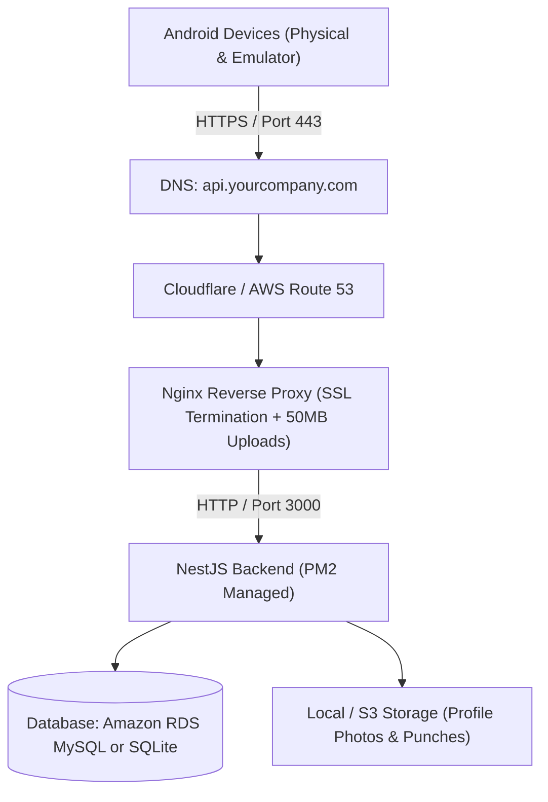

# AWS Backend Deployment & Configuration Guide
## Face-Verified Attendance App Backend (NestJS + TypeScript)

This document provides a comprehensive, production-ready guide to deploy the **Face-Verified Attendance App** backend on **Amazon Web Services (AWS)** with HTTPS (SSL), database persistence, automated restarts, and high-performance reverse proxying.

---

## Table of Contents
1. [Architecture Overview](#1-architecture-overview)
2. [Prerequisites & AWS Resources](#2-prerequisites--aws-resources)
3. [Environment Configuration (`.env`)](#3-environment-configuration-env)
4. [Deployment Method A: AWS EC2 + Nginx + PM2 (Recommended)](#4-deployment-method-a-aws-ec2--nginx--pm2-recommended)
   - [Step 1: Launch EC2 Instance & Security Groups](#step-1-launch-ec2-instance--security-groups)
   - [Step 2: Server Setup & Dependencies](#step-2-server-setup--dependencies)
   - [Step 3: Deploy Application Code](#step-3-deploy-application-code)
   - [Step 4: Configure PM2 Process Manager](#step-4-configure-pm2-process-manager)
   - [Step 5: Configure Nginx Reverse Proxy](#step-5-configure-nginx-reverse-proxy)
   - [Step 6: Setup Free SSL with Let's Encrypt](#step-6-setup-free-ssl-with-lets-encrypt)
5. [Deployment Method B: Docker & AWS App Runner / ECS (Containerized)](#5-deployment-method-b-docker--aws-app-runner--ecs-containerized)
6. [Database Options: RDS MySQL vs SQLite](#6-database-options-rds-mysql-vs-sqlite)
7. [Updating the Android App Configuration](#7-updating-the-android-app-configuration)
8. [Maintenance, Logging & Security Hardening](#8-maintenance-logging--security-hardening)

---

## 1. Architecture Overview



---

## 2. Prerequisites & AWS Resources

### AWS Account & Compute Sizing
- **AWS Account**: Active AWS account with billing enabled.
- **Recommended EC2 Sizing**:
  - **Development / Small Team (1–100 employees)**: `t3.small` (2 vCPU, 2 GB RAM) or `t3.micro` (Free Tier).
  - **Medium / Large Organization (100–5,000 employees)**: `t3.medium` (2 vCPU, 4 GB RAM).
- **Operating System**: **Ubuntu 24.04 LTS** or **Ubuntu 22.04 LTS (x86_64 / arm64)**.
- **Domain Name**: A custom domain (e.g. `yourcompany.com`) or subdomain (`api.yourcompany.com`) with access to manage DNS `A` records.

### Required Open Ports (Security Group)
| Port | Protocol | Source | Purpose |
| :--- | :--- | :--- | :--- |
| **`22`** | TCP | Your IP / `0.0.0.0/0` | SSH remote management |
| **`80`** | TCP | `0.0.0.0/0` | HTTP (Certbot SSL verification & Nginx redirect to HTTPS) |
| **`443`** | TCP | `0.0.0.0/0` | HTTPS (Secure Android API traffic) |
| **`3000`** | TCP | `127.0.0.1` (Local only) | Internal NestJS application port (Blocked from public access) |

---

## 3. Environment Configuration (`.env`)

Create a production `.env` file in `server/.env` with the following variables:

```env
# ==============================================================================
# SERVER CONFIGURATION
# ==============================================================================
NODE_ENV=production
PORT=3000
JWT_SECRET=SUPER_SECURE_RANDOM_JWT_SECRET_KEY_REPLACE_ME_32_CHARS
JWT_EXPIRES_IN=7d

# ==============================================================================
# DATABASE CONFIGURATION
# For SQLite (Simple file-based, zero extra cost):
DB_TYPE=sqlite
DB_SQLITE_FILE=attendance_prod.db

# For Amazon RDS MySQL (Recommended for multi-server / high scale):
# DB_TYPE=mysql
# DB_HOST=attendance-db.cxxxxxx.us-east-1.rds.amazonaws.com
# DB_PORT=3306
# DB_USERNAME=admin
# DB_PASSWORD=YourStrongDatabasePassword123!
# DB_DATABASE=attendance_prod
# DB_SYNCHRONIZE=false
# DB_LOGGING=false

# ==============================================================================
# OFFICE LOCATION & GEOFENCE CONFIGURATION
# ==============================================================================
DEFAULT_OFFICE_ID=DEFAULT_OFFICE
DEFAULT_OFFICE_NAME=Headquarters
DEFAULT_OFFICE_LAT=28.490293
DEFAULT_OFFICE_LNG=77.060544
DEFAULT_OFFICE_RADIUS_M=100
DEFAULT_OFFICE_TIMEZONE=Asia/Kolkata
DEFAULT_MATCH_THRESHOLD=0.55

# ==============================================================================
# FILE STORAGE & URLS
# ==============================================================================
UPLOAD_DIR=./uploads
BASE_URL=https://api.yourcompany.com
MODELS_BASE_URL=https://api.yourcompany.com/uploads/models
```

---

## 4. Deployment Method A: AWS EC2 + Nginx + PM2 (Recommended)

### Step 1: Launch EC2 Instance & Security Groups
1. Open the [AWS EC2 Management Console](https://console.aws.amazon.com/ec2/).
2. Click **Launch Instance**:
   - **Name**: `attendance-backend-prod`
   - **AMI**: `Ubuntu Server 24.04 LTS (HVM), SSD Volume Type`
   - **Instance Type**: `t3.small` (or `t3.micro`)
   - **Key pair**: Create or select an existing `.pem` SSH key pair (e.g. `attendance-key.pem`).
   - **Network settings**:
     - Allow SSH traffic from anywhere (or your IP).
     - Check **Allow HTTP traffic from the internet**.
     - Check **Allow HTTPS traffic from the internet**.
   - **Storage**: 20 GB gp3 SSD.
3. Click **Launch Instance**.
4. In the EC2 console, go to **Network & Security** ➔ **Elastic IPs** ➔ **Allocate Elastic IP**, then associate it with your new instance. This ensures your server IP never changes.
5. In your DNS provider (e.g. Cloudflare, GoDaddy, Route 53), add an **A Record**:
   - **Name**: `api` (or `attendance-api`)
   - **Target / Value**: Your EC2 Elastic IP (e.g. `54.210.xx.xx`)

---

### Step 2: Server Setup & Dependencies
Connect to your EC2 instance via SSH:
```bash
ssh -i attendance-key.pem ubuntu@YOUR_ELASTIC_IP
```

Update system packages and install Node.js 20 LTS, Git, Nginx, and build tools:
```bash
# Update Ubuntu package index
sudo apt update && sudo apt upgrade -y

# Install Node.js 20 LTS (NodeSource)
curl -fsSL https://deb.nodesource.com/setup_20.x | sudo -E bash -
sudo apt install -y nodejs build-essential git nginx certbot python3-certbot-nginx

# Verify installations
node -v   # Should show v20.x.x
npm -v    # Should show 10.x.x

# Install PM2 globally for production process management
sudo npm install -g pm2
```

---

### Step 3: Deploy Application Code
Clone your repository or upload your backend directory to `/var/www/attendance-backend`:

```bash
# Create directory and set permissions
sudo mkdir -p /var/www/attendance-backend
sudo chown -R ubuntu:ubuntu /var/www/attendance-backend

# Clone your repository (or copy files via SCP / SFTP)
cd /var/www/attendance-backend
git clone https://github.com/YOUR_ORG/attendance-app.git .
cd server

# Install dependencies and build TypeScript project
npm install
npm run build

# Create your production .env file
nano .env   # Paste your configuration from Section 3
```

Seed the initial office location and admin/employee users:
```bash
# Run database seed
npm run seed
```

---

### Step 4: Configure PM2 Process Manager
PM2 manages your NestJS application process, provides zero-downtime reloads, and restarts the backend automatically if the server reboots.

Create `ecosystem.config.js` in `/var/www/attendance-backend/server`:
```javascript
module.exports = {
  apps: [
    {
      name: 'attendance-api',
      script: 'dist/main.js',
      instances: 'max', // Utilizes all available CPU cores
      exec_mode: 'cluster',
      env: {
        NODE_ENV: 'production',
        PORT: 3000,
      },
      max_memory_restart: '800M',
      exp_backoff_restart_delay: 100,
      error_file: '/var/log/attendance-api-error.log',
      out_file: '/var/log/attendance-api-out.log',
      merge_logs: true,
      time: true,
    },
  ],
};
```

Start the application with PM2 and configure auto-startup on boot:
```bash
# Start backend application
pm2 start ecosystem.config.js

# Check status
pm2 status

# Save PM2 process list and configure systemd startup service
pm2 save
sudo env PATH=$PATH:/usr/bin pm2 startup systemd -u ubuntu --hp /home/ubuntu
```

---

### Step 5: Configure Nginx Reverse Proxy
Nginx receives external HTTPS traffic on port 443, handles SSL termination, allows large batch uploads (face images), and forwards requests to `http://127.0.0.1:3000`.

Create `/etc/nginx/sites-available/attendance-api`:
```bash
sudo nano /etc/nginx/sites-available/attendance-api
```

Paste the following configuration:
```nginx
server {
    server_name api.yourcompany.com;

    # Allow large multipart batch uploads for offline sync & profile photos
    client_max_body_size 100M;

    location / {
        proxy_pass http://127.0.0.1:3000;
        proxy_http_version 1.1;
        proxy_set_header Upgrade $http_upgrade;
        proxy_set_header Connection 'upgrade';
        proxy_set_header Host $host;
        proxy_set_header X-Real-IP $remote_addr;
        proxy_set_header X-Forwarded-For $proxy_add_x_forwarded_for;
        proxy_set_header X-Forwarded-Proto $scheme;
        proxy_cache_bypass $http_upgrade;
        proxy_read_timeout 120s;
        proxy_connect_timeout 60s;
    }

    # Serve uploads directly through Nginx for high throughput
    location /uploads/ {
        alias /var/www/attendance-backend/server/uploads/;
        expires 30d;
        add_header Cache-Control "public, no-transform";
        try_files $uri =404;
    }
}
```

Enable the configuration and restart Nginx:
```bash
sudo ln -sf /etc/nginx/sites-available/attendance-api /etc/nginx/sites-enabled/
sudo rm -f /etc/nginx/sites-enabled/default
sudo nginx -t
sudo systemctl restart nginx
```

---

### Step 6: Setup Free SSL with Let's Encrypt
Obtain and configure a free, auto-renewing SSL certificate:

```bash
sudo certbot --nginx -d api.yourcompany.com
```
- Enter your email address for renewal notices.
- Agree to terms and select **Yes** to automatically redirect HTTP traffic to HTTPS.
- Certbot will update the Nginx configuration automatically and establish a daily systemd timer for auto-renewal.

Test the backend health check in your browser or terminal:
```bash
curl -i https://api.yourcompany.com/v1/config
```

---

## 5. Deployment Method B: Docker & AWS App Runner / ECS (Containerized)

If you prefer containerized deployments without managing an EC2 instance:

### Create `server/Dockerfile`
```dockerfile
FROM node:20-alpine AS builder

WORKDIR /app
COPY package*.json ./
RUN npm ci

COPY . .
RUN npm run build

# Production image
FROM node:20-alpine AS runner

WORKDIR /app
ENV NODE_ENV=production

COPY package*.json ./
RUN npm ci --only=production

COPY --from=builder /app/dist ./dist
COPY --from=builder /app/uploads ./uploads

EXPOSE 3000
CMD ["node", "dist/main.js"]
```

### Deploy to AWS App Runner (Zero Server Management)
1. Push your Docker image to **Amazon Elastic Container Registry (ECR)**:
   ```bash
   aws ecr get-login-password --region us-east-1 | docker login --username AWS --password-stdin YOUR_AWS_ACCOUNT_ID.dkr.ecr.us-east-1.amazonaws.com
   docker build -t attendance-backend ./server
   docker tag attendance-backend:latest YOUR_AWS_ACCOUNT_ID.dkr.ecr.us-east-1.amazonaws.com/attendance-backend:latest
   docker push YOUR_AWS_ACCOUNT_ID.dkr.ecr.us-east-1.amazonaws.com/attendance-backend:latest
   ```
2. In AWS Console, open **App Runner** ➔ **Create service**:
   - **Source**: Container registry (Select ECR repository).
   - **Port**: `3000`.
   - **Environment Variables**: Add variables from Section 3.
3. App Runner automatically provisions HTTPS, auto-scaling (1–25 instances), and SSL certificates.

---

## 6. Database Options: RDS MySQL vs SQLite

| Feature | **SQLite (Default)** | **Amazon RDS MySQL (Production Multi-AZ)** |
| :--- | :--- | :--- |
| **Best For** | Single-instance EC2 (1–500 users) | High availability, auto-backups, multi-instance scale |
| **Setup Effort** | Zero setup (Embedded file) | Requires creating RDS MySQL instance |
| **Cost** | Free (Included in EC2 disk) | ~\$15–\$25/month (db.t4g.micro) |
| **Configuration** | `DB_TYPE=sqlite` | `DB_TYPE=mysql` + RDS Endpoint |

### To use Amazon RDS MySQL:
1. In AWS RDS Console, create a **MySQL 8.0** instance:
   - **Instance Class**: `db.t4g.micro` or `db.t4g.small`.
   - **Storage**: 20 GB gp3 with Auto-scaling enabled.
   - **Initial Database Name**: `attendance_prod`.
2. Attach the RDS instance to the same VPC / Security Group as your EC2 instance.
3. Update `.env` with the RDS endpoint, username, and password.

---

## 7. Updating the Android App Configuration

Once your AWS backend is live at `https://api.yourcompany.com`:

1. Open [`android/app/src/main/java/com/company/attendance/core/network/BackendConfig.kt`](file:///d:/Attendance%20App/android/app/src/main/java/com/company/attendance/core/network/BackendConfig.kt):
   ```kotlin
   object BackendConfig {
       const val PROD_BASE_URL = "https://api.yourcompany.com/v1/"

       fun getBaseUrl(): String = PROD_BASE_URL

       fun getFileUrl(path: String): String {
           val cleanPath = path.removePrefix("/")
           return if (path.startsWith("http")) path else "https://api.yourcompany.com/$cleanPath"
       }
   }
   ```
2. Build the final signed production APK (`Build` ➔ `Build APK(s)`).

---

## 8. Maintenance, Logging & Security Hardening

### 1. PM2 Commands Cheat Sheet
```bash
pm2 status                  # View CPU, memory, and status of backend workers
pm2 logs attendance-api     # View live real-time request logs
pm2 reload attendance-api   # Zero-downtime reload after code updates
pm2 restart attendance-api  # Full restart
```

### 2. Log Rotation
Prevent log files from filling up disk space:
```bash
pm2 install pm2-logrotate
pm2 set pm2-logrotate:max_size 50M
pm2 set pm2-logrotate:retain 10
```

### 3. Automated Daily Database Backup (Cron Job)
Create a daily backup script `/home/ubuntu/backup_db.sh`:
```bash
#!/bin/bash
BACKUP_DIR="/home/ubuntu/db_backups"
mkdir -p $BACKUP_DIR
TIMESTAMP=$(date +"%Y%m%d_%H%M%S")

# Backup SQLite database (or mysqldump for RDS)
cp /var/www/attendance-backend/server/attendance_prod.db $BACKUP_DIR/attendance_$TIMESTAMP.db

# Optional: Sync backup to private S3 bucket
# aws s3 cp $BACKUP_DIR/attendance_$TIMESTAMP.db s3://your-company-db-backups/

# Keep only last 14 days of backups
find $BACKUP_DIR -name "attendance_*.db" -mtime +14 -delete
```
Make executable and add to crontab:
```bash
chmod +x /home/ubuntu/backup_db.sh
crontab -e
# Add line: 0 2 * * * /home/ubuntu/backup_db.sh
```

### 4. Linux Firewall (UFW) Hardening
```bash
sudo ufw default deny incoming
sudo ufw default allow outgoing
sudo ufw allow 22/tcp
sudo ufw allow 80/tcp
sudo ufw allow 443/tcp
sudo ufw enable
```
